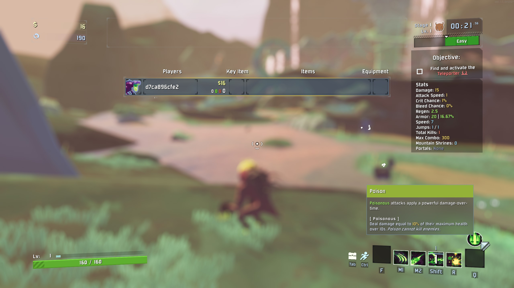

# PassiveSkillHud

A [Risk of Rain 2](https://store.steampowered.com/app/632360/Risk_of_Rain_2/) mod that shows your survivor's passive skill as a round icon above the skill bar. Open the scoreboard (Tab) and hover over the icon to read the passive's description, the same way you can for active skills.

- Passives you choose in the loadout, such as Acrid's Poison or Blight, show the one you picked. A survivor with several passives gets an icon for each.
- Keywords used in a passive's description (e.g. Poison) are explained under it, as on the character select screen.
- Follows whoever you're spectating, and updates when your survivor changes mid-run.
- Client-side only: other players don't need it.

## Configuration

`BepInEx/config/ntshtng.PassiveSkillHud.cfg`, or in-game if [Risk Of Options](https://thunderstore.io/package/Rune580/Risk_Of_Options/) is installed:

| Setting       | Default | Description                         |
| ------------- | ------- | ----------------------------------- |
| Show passives | `true`  | Enable or disable the mod entirely. |

Changes take effect immediately.

## Building

The build, deploy and package tasks are in [`mise.toml`](mise.toml): run them with [mise](https://mise.jdx.dev/) (`mise run <task>`), or run the `dotnet` command each one lists. The game, BepInEx and Risk Of Options assemblies come from NuGet, so no game install is needed to build.

Deploy copies the plugin into the `BepInEx/plugins/PassiveSkillHud` folder of your r2modman profile, `Default` unless you name another: `mise run deploy "My Profile"`. Undeploy removes that folder again; do this before installing the mod from Thunderstore into the same profile, or BepInEx finds two copies of the plugin.

Package builds the Thunderstore upload zip in `dist/`. The version, description and dependencies are set in `PassiveSkillHud.csproj`. The Thunderstore mod page comes from `THUNDERSTORE.md`, not this README, so keep the two in step when changing the user-facing parts.

To release, bump `<Version>` in `PassiveSkillHud.csproj`, add a section for it to `CHANGELOG.md` under a heading like `## 1.0.1`, and push `main` with a matching tag such as `v1.0.1`: `mise run release` does both, reading the version from `PassiveSkillHud.csproj`. CI then publishes a GitHub release with the Thunderstore zip attached, and uploads that zip to Thunderstore under the community and categories set in `PassiveSkillHud.csproj`, using the team service account token in the `THUNDERSTORE_SERVICE_ACCOUNT` secret. A version can only go to Thunderstore once, so if that upload fails, re-run just the failed job rather than tagging again.
